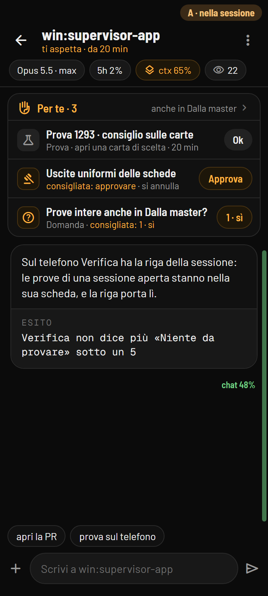
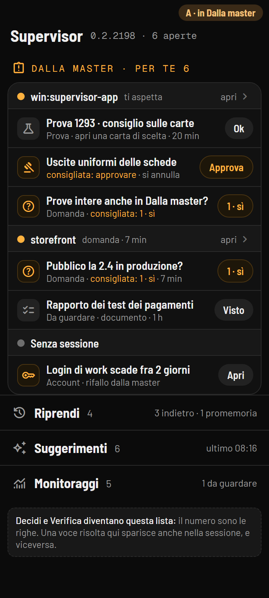
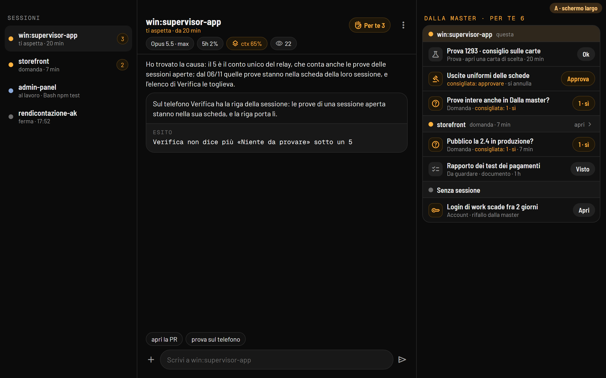
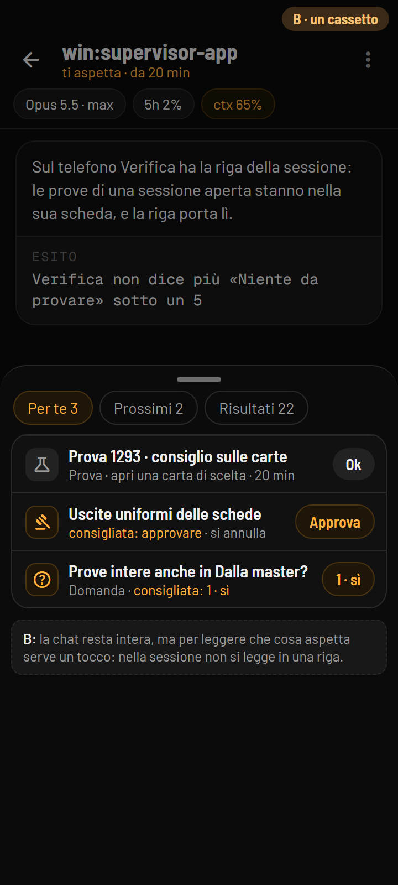
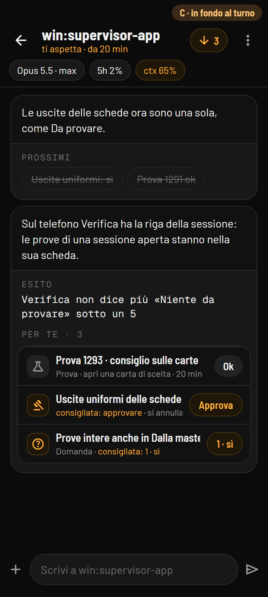

# Chiarezza della sessione: dove compare cosa, e come riallinearlo

Compito `app-analisi-chiarezza-16-11`. Chiesto da Franz il 16/11 alle 17:44, precisato alle 17:50. È un'analisi: nessun codice cambia con questo documento.

> «Vorrei fare una riflessione con te sullo stato attuale di Supervisor in quanto a chiarezza e linearità di utilizzo. […] tutte le informazioni aggiuntive (risultati, contesto, azioni suggerite, ti aspetta…) raccolte in maniera uniforme in uno o al massimo due posti dentro la finestra della sessione, compatte […]; su schermo largo in sezioni a parte che lasciano libere le sessioni; nessun doppione che chiede una conferma già data altrove.»
>
> «La possibilità di leggere l'informazione importante in una riga all'interno della sessione e anche nella sezione apposita che si trova in Dalla master, dove però una rimanda all'altra, la lascerei. […] Però bisogna svilupparlo in maniera integrata e sincronizzata e chiara. Abbiamo fatto molte modifiche e le cose sono diventate confusionarie: bisogna riallineare.»

Il modello di riferimento ha quindi due posti, con gli stessi dati, che si rimandano a vicenda:

- **(1) nella sessione:** una riga per ogni voce di quella sessione (decisione, prova, domanda), col consiglio e il tasto; il tocco apre la voce intera;
- **(2) in Dalla master:** il contenitore unico di tutte le voci, raggruppate per sessione, ognuna col rimando alla sua sessione.

Una voce chiusa in un posto sparisce anche nell'altro.

## In breve

1. Oggi le stesse cose (una prova, un ok, una domanda) compaiono in sei-otto posti fra telefono e web. Le leggiamo da sei fonti diverse e le contiamo in tre modi. Da qui vengono «Verifica 5» con l'elenco vuoto e «Uscite uniformi: sì» ancora toccabile un'ora dopo l'ok.
2. Nella sessione la chat ha fra il 38% e il 46% dello schermo del telefono, e i Prossimi della master compaiono tre volte nella stessa schermata.
3. Consiglio la **direzione A**: i due posti descritti da Franz, con una lista «Per te» nella sessione e un contenitore per sessione in Dalla master. Leggono le stesse voci da una fonte sola (`attese` del relay), così una voce chiusa in un posto sparisce anche nell'altro.
4. Nella sessione restano testata, «Per te» e chat. Azioni, Risultati e l'avviso del contesto diventano pillole, l'avviso delle altre sessioni un numero, e i Prossimi stanno solo sopra il campo. Con «Per te» ridotto a una riga la chat sale a circa due terzi.
5. L'ordine dei lavori: prima i dati (relay e app), poi le due viste, poi via i doppioni, infine il plugin. Lì vanno tolti la riga «Ti aspettano» a ogni messaggio della master e il consiglio ripetuto nel testo, e i Prossimi vanno legati alle loro voci.

## 1. Inventario delle superfici

Che cosa mostra ogni superficie oggi (0.2.2198), e da dove lo legge. Le immagini sono i golden dell'app Android, le catture della demo web e lo screenshot di Franz delle 18:07.

### Telefono (Android)

| Superficie | Che cosa mostra | Da dove | Immagine |
|---|---|---|---|
| Home › tabellone | ferme, al lavoro, utilizzo (conti) | `state` | [golden](../../mobile/src/test/snapshots/images/it.pixelbox.cmwatch.mobile_SummaryListTest_tabellone_filtro_ferme.png) |
| Home › «Ti aspettano» | le sessioni ferme per Franz, con la domanda e i tasti di risposta o di ok; aperte, anche le prove e le decisioni della sessione | `state.sessions[].question`, `needs_you`, `turn_blocking`, `state.approvals`; op `prove` e `decisioni` | [golden](../../mobile/src/test/snapshots/images/it.pixelbox.cmwatch.mobile_SummaryListTest_summaryOpenSubCards.png) |
| Home › Sessioni | ogni sessione su una riga (stato, esito o strumento, ctx), con le chip «Decidi N · Verifica N»; aperta, le sue decisioni e prove coi tasti | `state`, op `decisioni` e `prove` filtrate per sessione | [golden](../../mobile/src/test/snapshots/images/it.pixelbox.cmwatch.mobile_SummaryListTest_summaryTodoChips.png) |
| Home › Dalla master | Decidi (con Prima raccolta), Verifica (prove, prove fuse nelle decisioni, da guardare), Riprendi, Suggerimenti, Monitoraggi; il numero accanto a Decidi e Verifica viene da `state.tocca` | op `decisioni`, `prove`, `results`; `state.tocca` | screenshot di Franz delle 18:06 (Verifica 5, «Niente da provare») |
| Home › Lavori, Esiti, Strumenti | Notte, In corso, impegni con «Approva», Fatto oggi; esiti del giorno | `state.commitments`, `state.approvals`, KPI | [golden](../../mobile/src/test/snapshots/images/it.pixelbox.cmwatch.mobile_LavoriScreenTest_lavoriFull.png) |
| Sessione | testata (modello, 5h, ctx); avviso «N sessioni ti aspettano»; avvisi della sessione (`--bg`, nota di Claude Code); **Per te**; **Risultati**; chat a turni con ESITO e PROSSIMI, schede «prova #N», la domanda in fondo; **Azioni** (i Prossimi); ricorrenti; **Contesto al N%**; campo col primo Prossimo da usare | `state`, op `attese`, `results`, `transcript`, op `prove` col numero | [Per te ridotto](../../mobile/src/test/snapshots/images/it.pixelbox.cmwatch.mobile_PerTeScreenTest_reduced.png), [aperto](../../mobile/src/test/snapshots/images/it.pixelbox.cmwatch.mobile_PerTeScreenTest_open.png); la master alle 18:07 nel [mockup «Oggi»](../mockup/2026-11-16-chiarezza/oggi-notte.png) |
| Scheda «Ti aspetta» (`#/attesa/<id>`) | la carta intera di una voce: ok, scelta con le immagini, prova; consiglio e «consigliata» | op `attesa` | [golden](../../mobile/src/test/snapshots/images/it.pixelbox.cmwatch.mobile_SceltaScreenTest_phone.png) |
| Pagine Da provare, Da decidere, Ti aspetta, Da guardare | le stesse voci delle sezioni, a tutta pagina | op `prove`, `decisioni`, `attese`, `results` | [Da provare](../../mobile/src/test/snapshots/images/it.pixelbox.cmwatch.mobile_DecideScreenTest_banco_prova_installata.png), [Da decidere](../../mobile/src/test/snapshots/images/it.pixelbox.cmwatch.mobile_DecideScreenTest_cinque_minuti_una.png) |
| Barra della master, Home in riga | l'ultimo messaggio della master; sotto la master a tutto schermo, la Home in una riga di voci | `state`, `transcript` | — |
| Notifiche | domanda, esito, avvisi forti (`attention`), quota, turno fallito, promemoria, server MCP, impegni fermi | diff dello `state`, eventi | — |

### Tablet

La plancia ha le stesse superfici in colonne: Sessioni, le categorie della Home (Dalla master, Lavori…), e le sessioni aperte in colonna con gli stessi blocchi della sessione del telefono. La testata «Dalla master» della plancia ha un conto suo, calcolato dalle pagine senza le sessioni aperte. Golden: [plancia](../../mobile/src/test/snapshots/images/it.pixelbox.cmwatch.mobile_TabletShellTest_tabletDesk.png), [Per te sul tablet](../../mobile/src/test/snapshots/images/it.pixelbox.cmwatch.mobile_PerTeScreenTest_tablet.png).

### Web (telefono e schermo largo)

Ha le stesse superfici, con lo stesso ordine e le stesse fonti (`Home.svelte`, `Chat.svelte`). Sotto Verifica c'è dal 12/11 una riga per ogni sessione aperta con prove («win:supervisor-app · 5 prove nella sua scheda ›»). Catture della demo: [sessione](../mockup/2026-11-16-chiarezza/oggi-web-sessione-telefono.png), [Dalla master](../mockup/2026-11-16-chiarezza/oggi-web-home-telefono.png) e [schermo largo](../mockup/2026-11-16-chiarezza/oggi-web-largo.png).

### Orologio

La tile mostra per la sessione seguita lo strumento, l'esito o il prossimo passo; le complicazioni i conti. Le notifiche portano la domanda con le risposte, l'esito, la sessione chiusa, la quota, la sessione ferma e gli avvisi. Ci sono poi la schermata della sessione e il Live a voce. Golden: [scheda della sessione](../../wear/src/test/snapshots/images/it.pixelbox.cmwatch.wear_ScreensSnapshotTest_card.png), [domanda](../../wear/src/test/snapshots/images/it.pixelbox.cmwatch.wear_ScreensSnapshotTest_question.png), [Live](../../wear/src/test/snapshots/images/it.pixelbox.cmwatch.wear_LiveScreenSnapshotTest_liveOutcome.png).

### La master (testo, dal plugin)

- A ogni prompt della master l'hook aggiunge la riga «Ti aspettano: … Dillo all'utente, in breve, anche se si parla d'altro» (`cm-hook.py`, `waiting_for_you`, contratto 1.68), letta da `last-state.json` (`attention` e `approvals`). Per questo la master ripete i «Ti aspettano» in ogni messaggio.
- In fondo a ogni turno ci sono le righe `Esito:`, `Tipo:`, `Prossimi:` e `Watch:` (regole 9 e 10 del kernel), lette dal relay con espressioni regolari (`cm-hosts.py`, `TAIL_LINE`).

## 2. Matrice dei doppioni

Per ogni voce: dove compare oggi, da quale fonte, e se chiusa in un posto sparisce negli altri.

| Voce | Dove compare (telefono e web) | Fonti | Chiusa in un posto, sparisce negli altri? |
|---|---|---|---|
| **Prova** | Dalla master › Verifica; scheda della sessione in Home (chip «Verifica N», aperta); sessione › Per te; pagina Da provare; scheda Ti aspetta; schede «prova #N» nei messaggi; Prossimi della master («Prova 1293 ok»), anche in Azioni e nel campo («Usa»); conti di menu e tabellone | op `prove`; `attese`; op `prove` col numero; testo della master; `state.tocca` | Fra Verifica, scheda della sessione e Da provare **subito** (insieme comune `ProveSent` / `proveSent`). In Per te e Ti aspetta solo quando lo stato cambia e `attese` viene riletta (secondi, con l'app aperta). Nei Prossimi della master **mai**: sono testo. |
| **Ok di un compito, scelta** | Dalla master › Decidi; scheda della sessione in Home (chip «Decidi N», aperta); Per te; scheda Ti aspetta; Home «Ti aspettano» (tasti sulla scheda della sessione e scheda della master coi suoi ok); Lavori («Approva» sull'impegno); riga «Ti aspettano» della master; Prossimi della master («Uscite uniformi: sì»); notifica | op `decisioni`; `attese`; `state.approvals`; `state.commitments`; `last-state.json`; testo | Solo **dove si tocca**. Non c'è un insieme comune, quindi altrove la voce sparisce alla spinta dello stato. Nel testo della master **mai**. |
| **Domanda della sessione** (AskUserQuestion, permesso) | chat (la domanda in fondo); Per te; scheda Ti aspetta; Home «Ti aspettano» coi tasti; avviso «N sessioni ti aspettano» nelle altre sessioni; notifiche di telefono e orologio; schermata della domanda sull'orologio; riga «Ti aspettano» della master | `state.sessions[].question`; `attese`; `last-state.json` | Le viste che leggono lo stato si allineano insieme alla spinta successiva; Per te e Ti aspetta alla rilettura di `attese`; le notifiche si chiudono col diff. |
| **«Serve te»** (needs_you, Prossimi con «!») | Home «Ti aspettano» (motivo e «Fatto»); Per te; scheda Ti aspetta; avviso forte; riga «Ti aspettano» della master; PROSSIMI con «!» nel turno e in Azioni | `state.attention`, `needs_you`, `turn_blocking`; `attese`; testo | Come la domanda; i Prossimi con «!» restano nel testo. |
| **Da guardare** (risultato consegnato) | sessione › blocco Risultati; Per te (voce «Visto»); Dalla master › Verifica; pagina Da guardare; schede dei risultati nei messaggi | op `results`, `state.results` | «Visto» aggiorna `n_unseen` nello stato: si allineano alla spinta. |
| **Esito** | nel turno (ESITO); riga della sessione in Home; Esiti in Home; notifica d'esito; tile dell'orologio; la master lo riassume | `state.sessions[].outcome`; testo | È informazione, non chiede niente: il problema è lo spazio, non la sincronia. |
| **Prossimi** | nel turno (PROSSIMI); blocco Azioni con gli stessi; il primo nel campo («Usa»); riga della sessione in Home; tile dell'orologio | testo del turno | Tre volte nella stessa schermata; non sanno se la voce a cui rimandano è già chiusa. |
| **Contesto** | pillola ctx in testata; avviso «Contesto al N%» con «Fallo»; barra della master; riga della sessione | `state.sessions[].context` | Informazione; l'avviso prende 55-60 px. |
| **Consiglio** | riga «Consiglio: …» della carta e «consigliata» sull'opzione (contratto 1.149); lo stesso consiglio scritto nel messaggio | `attese`, `attesa`; testo | Il testo non sa che la carta lo porta già. |
| **Conti** | tabellone, menu, numeri di Decidi e Verifica: `state.tocca` (tutte le voci, anche delle sessioni aperte); testata «Dalla master» della plancia: le pagine senza le sessioni aperte; chip della sessione: le pagine filtrate per sessione; Per te: `attese` | tre calcoli | Numeri diversi per le stesse voci. |

Casi veri del 16/11:

- **18:06, telefono:** «Verifica 5», aperta, diceva «Niente da provare.». Il 5 è `state.tocca.prove`, che conta anche le prove delle sessioni aperte; l'elenco le toglie, perché dal 06/11 stanno nella scheda della loro sessione. Lo stesso sintomo Franz l'aveva segnalato sul web il 12/11 («dice 30 ma ne vedo 1»). Allora il web ebbe la riga per sessione (`1b809572`), il telefono no. Corretto stasera sul telefono con `d387094d` (`app-verifica-vuota-16-11`).
- **Web, demo:** «Decidi 3», aperta, dice «Fatto: per ora basta.» ([cattura](../mockup/2026-11-16-chiarezza/oggi-web-home-telefono.png)). È lo stesso difetto per le decisioni, su web e telefono, ed è ancora aperto.
- **11:15:** «Uscite uniformi: sì» toccato su una voce approvata alle 10:14. Era un Prossimo della master, cioè testo in un messaggio vecchio.
- **19:31-19:37:** Franz ha chiuso le prove 1290-1293 e 1260 scrivendo alla master («Prova 1293 ok», «Prova 1290 ok e prova 1260 ok»), mentre l'app sul telefono le nascondeva.
- **18:07, la master:** «Prova 1293 ok» c'è tre volte nella stessa schermata: chip nel turno, campo «Usa» e, per le altre due, il blocco Azioni ([mockup «Oggi»](../mockup/2026-11-16-chiarezza/oggi-notte.png)).

## 3. Spazio verticale nella sessione

| Dove | Misura | Chat |
|---|---|---|
| Telefono, la master alle 18:07 (screenshot di Franz, 1410 px utili) | testata 200 · Risultati 70 · **chat 650** · Azioni aperte 232 · Contesto 108 · campo 115 | **46%** |
| Web, demo, storefront (412 × 879 utili) | testata 133 · avviso altre sessioni 44 · Per te aperto 214 · Risultati 46 · **chat 334** · campo 76 | **38%** |
| Web, demo, payments-api | testata 133 · avviso 44 · Per te 158 · Risultati 46 · **chat 390** · campo 76 | **44%** |
| Direzione A, Per te aperto con 3 voci (mockup) | testata · Per te 193 · chat · Prossimi e campo | **48%** |
| Direzione A, Per te ridotto a una riga | testata · Per te 46 · chat · Prossimi e campo | **≈ 67%** |

Sullo schermo largo ogni colonna di sessione ripete gli stessi blocchi, quindi lo spazio perso si moltiplica per le colonne aperte.

## 4. Direzioni

I mockup sono in [`docs/mockup/2026-11-16-chiarezza/`](../mockup/2026-11-16-chiarezza/) (HTML con `?p=<tavola>` e `?day`; PNG notte e giorno). Le voci sono le stesse in tutte le tavole: la prova 1293, l'ok «Uscite uniformi» col consiglio, una domanda. Tutte e tre le direzioni hanno lo stesso Dalla master; cambia la sessione.

### A · Una riga nella sessione, un contenitore in Dalla master (consigliata)

| Nella sessione | In Dalla master | Schermo largo |
|---|---|---|
|  |  |  |

- **Nella sessione (1):** la testata con le pillole (ctx in ambra quando conviene un handoff, e il tocco lo propone; quella dei risultati col loro numero) e **una sola lista «Per te»**. Ogni voce sta su una riga: icona, titolo, il consiglio («consigliata: approvare»), il tasto principale. La lista si riduce a una riga col primo elemento, come i blocchi del 12/11, e in testa ha il rimando «anche in Dalla master ›». Poi la chat: il turno tiene la risposta e l'ESITO. I Prossimi stanno **solo** sopra il campo, e uno che chiude una voce già in «Per te» non c'è. Spariscono Azioni, il blocco Risultati, l'avviso del contesto, l'avviso delle altre sessioni (diventa un numero sul tasto indietro) e i PROSSIMI dentro il turno.
- **In Dalla master (2):** un contenitore «Per te», raggruppato per sessione. Il titolo del gruppo porta alla sessione; le righe e i tasti sono gli stessi della sessione. Decidi e Verifica diventano questa lista, e il numero sono le righe. Riprendi, Suggerimenti e Monitoraggi restano sezioni loro: non aspettano una risposta.
- **Schermo largo:** le sessioni restano libere, con nella testata solo «Per te 3». Dalla master è la colonna accanto, sempre in vista, col gruppo della sessione aperta acceso. È la «sezione a parte che lascia libere le sessioni».
- **Pro:** è il modello delle 17:50, ha la riga nella sessione e il rimando, e un solo formato di voce (già fatto: il «formato unico» del 12/11). Lo spazio torna alla chat e ogni conferma ha due posti soli, sincronizzati.
- **Contro:** chiede di riallineare i dati prima delle viste (sezione 6), e qualche pillola nuova in testata da imparare.

### B · Un cassetto

Nella sessione non c'è niente sopra la chat. Sopra il campo una sola barra («Per te 3 · Prossimi 2 · Risultati 22») apre un foglio con le tre schede; sul largo, un pannello a lato di ogni sessione.

- **Pro:** la chat è intera.
- **Contro:** per sapere che cosa aspetta serve un tocco, e nella sessione l'informazione importante non si legge in una riga, che è quello che Franz vuole tenere.

### C · In fondo al turno

Le voci stanno nella risposta che le chiede, in fondo al turno con ESITO; in testata un «↓ 3» porta lì quando il turno è scrollato via.

- **Pro:** si legge come una conversazione, senza blocchi fissi.
- **Contro:** le voci si spostano con la chat, e i turni vecchi tengono le loro copie, superate o da barrare: è il problema dei doppioni dentro la chat stessa. Mescola anche il contenuto della sessione coi comandi.

**Perché A:** è l'unica che tiene insieme le tre cose chieste: la riga nella sessione, il contenitore in Dalla master che rimanda, e la chat libera. B toglie la riga; C rimette i doppioni nella chat.

## 5. Ogni superficie con A: (1), (2) o via

| Superficie di oggi | Con A |
|---|---|
| Sessione › Per te | **(1)**: l'unica lista della sessione |
| Sessione › domanda in fondo alla chat | **(1)**: è una voce di Per te; il tocco apre la scheda con tutte le risposte |
| Sessione › Risultati (blocco) | via: i non visti sono già voci di Per te («Visto»); l'elenco intero da una pillola della testata |
| Sessione › Azioni | via: i Prossimi in un posto solo, sopra il campo |
| Sessione › PROSSIMI nel turno | via; l'ESITO resta nel turno |
| Sessione › primo Prossimo nel campo («Usa») | unito ai Prossimi sopra il campo |
| Sessione › «Contesto al N%» | nella pillola ctx della testata |
| Sessione › «N sessioni ti aspettano» | un numero sul tasto indietro, che porta a Dalla master |
| Sessione › avvisi `--bg` e nota di Claude Code | restano: avvisano, non chiedono |
| Home › «Ti aspettano» (tasti sulle schede delle sessioni, scheda della master coi suoi ok) | via i tasti: la scheda dice «Per te N ›» |
| Home › scheda della sessione aperta con decisioni e prove | via: la chip «Per te N» porta alla sessione |
| Home › Dalla master › Decidi, Verifica, righe per sessione, Prima raccolta | **(2)**: un contenitore «Per te» per sessione (Prima raccolta ne è una voce senza sessione) |
| Home › Dalla master › Riprendi, Suggerimenti, Monitoraggi | restano sezioni loro |
| Lavori › «Approva» sugli impegni | via il tasto: «aspetta il tuo ok ›» porta alla voce |
| Pagine Da provare, Da decidere, Ti aspetta | viste filtrate di (2), con le stesse righe, oppure via dal menu |
| Scheda Ti aspetta (`#/attesa/<id>`) | resta: è la voce intera, aperta da (1) e da (2) |
| Plancia (tablet, web largo) | la colonna Dalla master è (2), sempre in vista; nelle colonne delle sessioni solo «Per te N» |
| Notifiche di telefono e orologio | restano, con l'id della voce: si chiudono quando la voce è chiusa ovunque |
| Orologio: tile e complicazioni | restano; i numeri dalla stessa lista |
| Menu «Tocca a te», tabellone | il numero di (2) |
| Master: riga «Ti aspettano» a ogni messaggio | via (plugin) |
| Master: Prossimi che chiudono una voce | rimandi alla voce (plugin) |

## 6. Una fonte sola per le voci: `attese`

Oggi le stesse voci arrivano da sei fonti: `attese`, `decisioni`, `prove`, `state` (`approvals`, `attention`, `question`, `needs_you`), `commitments` e il testo dei messaggi. Si contano poi in tre modi (`state.tocca`, pagine senza le sessioni aperte, `attese`).

Il relay ha già la lista giusta: **`attese`** (contratto 1.130). Raccoglie le carte (ok, scelta, pausa, prova, login) e le domande in chat (Prossimi con «!», needs_you, AskUserQuestion), ognuna con un id stabile, il link, l'op che risponde e i tasti pronti. Mancano quattro cose:

1. **I risultati da guardare:** oggi stanno in `results`; vanno dentro `attese` come tipo «guarda», oppure restano una seconda fonte dichiarata.
2. **I conti:** `state.tocca` va calcolato dalle stesse `attese` (anche per sessione), così il numero sono le righe per costruzione.
3. **La voce chiusa:** quando una voce si chiude, il suo id va nello stato o nella spinta, così ogni dispositivo la toglie subito, senza aspettare la rilettura.
4. **Nell'app:** un solo insieme «già risposte» per id, per tutte le voci e tutte le viste (oggi c'è solo per le prove, e non arriva a Per te).

## 7. Che cosa cambia nel plugin

1. **La riga «Ti aspettano»** (`cm-hook.py`, `waiting_for_you`, contratto 1.68) non va più a ogni prompt della master. Al più una volta, quando entra una voce nuova, col link: le voci le mostra l'app.
2. **I Prossimi che chiudono una voce** («Prova 1293 ok», «Uscite uniformi: sì»): con la carta aperta non vanno nei Prossimi, perché il tasto è sulla carta. Se servono, un Prossimo porta l'id della voce (per esempio `! #wd2f87e85e2`), e l'app lo mostra con lo stato vero: chiusa, non si tocca più.
3. **Esito, Tipo, Prossimi, Watch:** oggi sono righe di testo in coda al messaggio (regole 9 e 10 del kernel), lette con espressioni regolari. Proposta: campi del turno scritti in modo esplicito (un comando di fine turno o un blocco riconosciuto dall'hook) e salvati nello stato, coi Prossimi legati alle voci. Il testo del messaggio non li ripete.
4. **Il consiglio:** con la carta aperta (contratto 1.149) la sessione non lo riscrive nel messaggio; scrive una riga col link della carta.
5. **Le prove:** una prova si chiede con la sua carta; la master non la richiede anche nei Prossimi.
6. **I conti:** `state.tocca` dalle `attese`.

## 8. L'ordine del riallineamento

Ogni passo è una carta sua, una alla volta, con la prova di Franz.

1. **Dati.** Relay: `attese` come fonte unica, i conti dalle `attese`, l'id della voce chiusa nello stato. App: un solo archivio delle voci per id e un solo insieme «già risposte». Test: la stessa fixture di `attese` letta da web e Kotlin, con numero uguale alle righe.
2. **Le due viste.** Lo stesso componente di voce del formato unico (`Voce`, `VoceRow`): (1) «Per te» nella sessione, (2) Dalla master per sessione, e la colonna sullo schermo largo. Test e golden.
3. **Via i doppioni.** Azioni, PROSSIMI nel turno, blocco Risultati, avviso del contesto, avviso delle altre sessioni, tasti in Home «Ti aspettano», schede aperte delle sessioni in Home, «Approva» in Lavori, pagine doppie.
4. **Plugin.** La riga «Ti aspettano», i Prossimi legati alle voci, il consiglio senza ripetizioni, l'esito strutturato.

Il passo 1 viene prima perché, finché le fonti sono sei, due viste non possono restare allineate: «Verifica 5» con l'elenco vuoto e «Uscite uniformi: sì» un'ora dopo l'ok sono due sintomi della stessa causa.

## 9. Difetti trovati durante l'analisi

| Difetto | Stato |
|---|---|
| Telefono: «Verifica 5», aperta «Niente da provare» | corretto: `d387094d` (`app-verifica-vuota-16-11`), riga per sessione come sul web |
| Web e telefono: «Decidi N» conta le decisioni delle sessioni aperte ma non le elenca («Fatto: per ora basta») | aperto: stesso rimedio di Verifica, o il passo 1-2 |
| Per te (sessione) e Verifica/Decidi (Home) non condividono le risposte già mandate | aperto: passo 1 |
| Gli ok non hanno un insieme comune fra Decidi, Per te, Home «Ti aspettano» e Lavori | aperto: passo 1 |
| I Prossimi della master restano toccabili dopo che la voce è chiusa | aperto: passo 4 |

## 10. Da decidere con Franz

1. Confermi la direzione A?
2. In Dalla master, le voci delle sessioni aperte per intero, coi tasti (come nei mockup), o una riga per sessione che porta lì (come oggi sul web e da stasera sul telefono)?
3. Sullo schermo largo, nelle colonne delle sessioni solo il numero «Per te N», con le voci nella colonna Dalla master, o anche lì la lista?
4. La chip «Per te N» sulla scheda della sessione in Home: porta alla sessione o al suo gruppo in Dalla master?
